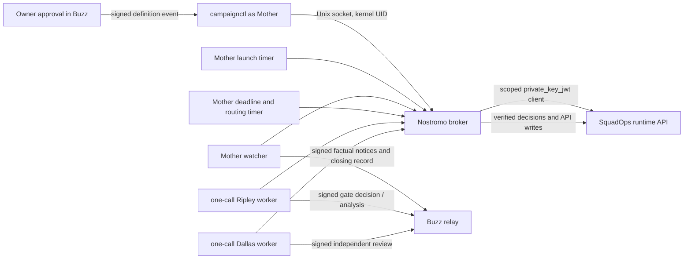

# Nostromo campaign execution harness

This document describes the campaign execution adapter built in Nostromo for operating
SquadOps campaigns from the Buzz crew. It covers the control flow, identities, signatures,
review automation, Spark service layout, and privilege boundaries.

The harness is an adapter and safety layer. **SquadOps remains the authority for campaign
state, cycles, runs, proposals, gate state, accepted trees, and campaign outcomes.** Nostromo
stores owner approvals, local launch workflows, request receipts, bounded review jobs, and
observations needed to safely operate that runtime. It does not make the Nostromo GitHub
repository the target project's campaign database.

For command syntax and the owner-operated runbook, see
[Campaign control from Buzz](runbooks/campaign-control.md). For maintenance, see
[Release deployment](runbooks/deployment.md), including authenticated root steps, and
[Spark campaign-control installation evidence](../infrastructure/spark/evidence/campaign-control-2026-10-24.md).

## Design goals

- Bind every campaign to one immutable, owner-approved definition, project, Buzz channel, and
  fresh top-level Buzz thread.
- Identify callers from their Linux UID, then apply a small command allowlist; do not expose a
  generic SquadOps API proxy to crew processes.
- Require signed Buzz evidence for owner definitions, role decisions, and independent reviews.
- Keep decision authority separate: Mother operates and routes; Ripley rules on plan and
  increment gates; Dallas independently reviews Ripley's exact decision; the owner approves
  definitions, budgets, and exceptional recovery.
- Bound provider calls with immutable shared allowances, per-campaign dispatch counts, deadlines,
  one-call reservations, fixed models, request and response limits, and no automatic retries.
- Stop at missing evidence, policy mismatch, ambiguous writes, worker failure, blocking review,
  or exhausted time/budget. Do not turn uncertainty into approval.
- Give campaign services only the Spark rights they need. Crew accounts do not receive sudo,
  Docker access, or general systemd control.
- Keep launch, polling, deadline enforcement, and factual reporting deterministic and model-free.

## Components and trust boundaries



### Authoritative records

| Record | Authority |
|---|---|
| Owner-approved definition, digest, allowed channel/thread, local caller and request receipts | Nostromo broker SQLite state |
| Campaign, cycles, runs, proposals, gate state, accepted tree, ledger, campaign outcome | SquadOps runtime |
| Signed owner/role statements and coordination/reporting thread | Buzz events and notes |
| Provider usage response, bounded reservation and recovery status | Nostromo review-job state; role-private recovery file when publication recovery is needed |

The broker correlates these records and verifies bindings. A local receipt is not proof that a
remote operation committed; ambiguous outcomes are reconciled against SquadOps's control log.

## Who can do what

| Identity | Allowed harness responsibility | Deliberately unavailable |
|---|---|---|
| Owner | Approve immutable definitions and review budgets; authorize publication recovery; restore shared mode after verification | The harness does not infer owner intent or enlarge an existing approval |
| Mother | Request durable launch; create/start/pause/resume/abort its registered campaigns; route bounded reviews; publish factual monitoring | No gate verdict; no arbitrary API path; no owner override; no model call from launcher/advance/watcher |
| Ripley | Submit plan/increment decisions after Dallas review; provide closing interpretation | No campaign create/start/pause/abort; no direct gate write without signed proof; no automatic retries |
| Dallas | Independently review the exact Ripley decision and binding | No campaign operations or gate submission |
| Watcher | Read tracked campaign state, publish factual transitions and closing record | No verdict, gate decision, implementation action, or provider call |
| Broker service | Validate requests, enforce local policy, hold API signing clients, make only fixed API calls | No general shell/API proxy; no owner identity, admin role, Docker access, or unrestricted systemd authority |
| Parker/Brett | Implementation and acceptance work under the existing project/repository controls | The campaign broker does not grant target-repository write authority or bypass repository checks |

SquadOps composes the API roles into three service principals, provisioned in the `squadops-local`
realm:

| Broker principal | API roles | Use |
|---|---|---|
| `campaign-operations` | `campaign-supervisor` | Campaign lifecycle and owner-bounded gate operations routed through the broker |
| `campaign-review` | `campaign-supervisor`, `operator` | Separate review-side operations required by the deployed API contract |
| `campaign-evidence` | `campaign-triage` | Read campaign evidence and status |

Provisioning checks that none of these service accounts has the realm `admin` role. The broker
does not hold `campaigns:control`. The concrete API permission bundles are defined by SquadOps;
Nostromo restricts which broker commands can exercise the clients.

## Campaign definition and approval

An owner-approved definition includes the target `project_id`, objective and scope, measurable
acceptance criteria, runtime policy, and optionally a scenario suite and crew automation policy.
The objective must name allowed paths and an accepted-increment target. Runtime bounds include
cycle count, elapsed time, and SquadOps token allowance. If paid reviews are enabled, the crew
section binds an already owner-approved review budget, a hard deadline, a required Dallas review,
inference mode, and maximum dispatch count.

Approval is immutable by name. The broker computes a canonical SHA-256 digest. Changing scope,
limits, thread, or review policy needs a new approval/name. An approval authorizes one campaign
creation; retries with new request IDs cannot multiply it.

The current local owner path accepts the owner UID in `core.py` (`approve-definition`);
`approve-budget` has the same owner-UID shortcut. An AI session acting under the owner UID therefore
holds this authority. AI coding sessions (Codex, Claude Code) have no crew identity: they use
`nostromo@spark` for deploys and `jladd@spark` only for read-only campaign reads, and never invoke
owner-only approval commands unless the owner asks for that action. These shortcuts are being replaced by signed Buzz approvals, verified through
the same remote approval path. For a remote Buzz approval, the owner publishes
one exact `campaign-definition: {...}` line in an admitted channel. Mother imports the event by
ID; the broker verifies the event kind, owner's pinned public key, freshness, channel, signature,
and exact payload. The approved definition is stored with its digest and approved Buzz root.

An attended campaign gets a new top-level post in `#squadops-campaigns`; its root event is bound
into the immutable approval. Replies and reporting remain on that campaign's thread. A definition
or thread cannot be reused for a different launch.

## Durable launch protocol

The no-model `nostromo-campaign-launch.timer` runs every 30 seconds as Mother. `campaignctl
launch` creates a durable intent; it is **not** itself confirmation that a campaign started.
The fixed operation IDs, campaign ID, approved definition digest, destination thread, and deadline
are persisted before asynchronous continuation.

The launcher advances through these phases:

1. Validate owner approval, destination, one-use definition, fresh thread, shared budget, and
   deadline.
2. Create the SquadOps campaign once using the approved objective and policy, excluding local
   Nostromo-only crew metadata from the SquadOps API body.
3. Read back the created campaign and compare its project, objective, policy, and campaign ID with
   the approved values. Reject a mismatch.
4. Publish and verify a signed announcement in the approved thread.
5. Start the campaign once and publish a signed start receipt.

The launch intent deadline is fixed at acceptance, at most ten minutes and no later than the
approved `automation.not_after`. After a write with an ambiguous transport outcome, the worker
reads the broker receipt and SquadOps control log; it never repeats an uncertain create/start.
The same request ID and content can be used to read the intent status. A new ID cannot be used to
repeat it. An unverified announcement does not authorize start. Notices persist the exact signed
event in a private Mother-owned outbox, reuse its event ID, and have at most three bounded
publication attempts. Unresolved launch, event, or scenario-suite evidence becomes `blocked` and
requires owner inspection.

Legacy manual create/start is retained for definitions without a durable launch reservation. It
cannot bypass an intent once a definition has been bound to the durable flow.

## Broker protocol and operation safety

`campaignctl` accepts one JSON object and sends it over
`/run/nostromo-campaigns/control.sock`. It does not accept shell commands. The broker:

- obtains the peer UID using Linux `SO_PEERCRED` and maps that UID to an admitted role;
- rejects caller-supplied role identity, unknown fields, unknown commands, malformed IDs, and
  excessive or incomplete requests;
- accepts only fixed read, lifecycle, gate, evidence, launch, and review commands;
- validates campaign membership, cycle/run binding, gate state, policy, stable request IDs, and
  required signatures before calling SquadOps;
- uses role-specific API clients and fixed API paths; redirects and caller-supplied URL/query
  parameters are rejected;
- records immutable request fingerprints and durable pending/done receipts in SQLite; and
- returns generic errors for unexpected exceptions rather than logging request bodies, tokens, or
  provider response text.

Every operation write uses a stable request ID. A completed identical request replays its receipt.
A reused ID with different content is refused. A pending/ambiguous outcome is not automatically
repeated; inspect the broker receipt and SquadOps control log.

The broker can register owner approval and verify gate signatures, but it never exposes a raw
SquadOps API route, arbitrary cycle write, user-selected HTTP method, owner override, or role
impersonation field. Campaign runtime records remain authoritative after creation.

## Gate decisions and independent review

The plan gate and increment gate have distinct decision processes. Mother does not decide whether
a plan or increment passes. The automatic review path is opt-in per immutable definition; no
automation section means no paid dispatch.

### Routing and decision order

1. The no-model advance worker polls tracked campaigns every 30 seconds, enforces deadlines, and
   checks for supported waiting gates.
2. SquadOps receives a 30-second interval for its own no-open-questions automatic approval before
   Nostromo queues Ripley's review.
3. Ripley receives one complete bounded packet with the campaign objective, policy, gate, selected
   full evidence, artifact digests, and allowed evidence-reference IDs. The packet is capped at
   65,536 serialized bytes.
4. Ripley returns a strict structured decision. Available decisions are `approved`, `rejected`,
   `returned_for_revision`, and `needs_owner`; revision is removed from the schema if immutable
   campaign/cycle policy or run history shows no revision remaining.
5. Dallas receives the exact proposed decision and binding, not an independently reinterpreted
   paraphrase. Dallas's signed response must bind the campaign, cycle, run, and digest of Ripley's
   decision. A blocking review parks the campaign.
6. Only a valid non-blocking Dallas response permits Ripley's deterministic submission worker to
   send the gate decision to SquadOps. Submission includes signed Ripley and Dallas events and,
   for increment decisions, the proposal ID/version/content hash/baseline tree binding.

There is no automatic disagreement, revision, repair, or retry loop. Missing evidence, an owner
decision, policy mismatch, blocking review, worker error, stale gate, ambiguous submission, or
exhausted allowance parks the campaign for inspection. A parked or expired campaign cannot be
resumed by Mother to bypass the hold.

### Provider call boundary and accounting

Each review is one direct HTTPS request by the role-owned worker:

| Role | Pinned model | Credential file | Provider endpoint |
|---|---|---|---|
| Ripley | `gpt-5.6-sol` | `/home/ripley/.config/nostromo/secrets/openai.key` | OpenAI Responses API |
| Dallas | `claude-opus-5-5` | `/home/dallas/.config/nostromo/secrets/anthropic.key` | Anthropic Messages API |

The worker has no tools, follow-up conversation, model fallback, SDK retry policy, automatic
provider retry, premium service tier, or arbitrary model selection. It checks model and request
size, disables redirects, sets a time bound, validates strict JSON output and evidence references,
then signs the result for Buzz. Tokens are short-lived at the provider boundary; provider keys
remain in the role's private home.

An owner separately approves a shared immutable allowance. The first-pilot validator caps that
allowance at $10 and 20 dispatches; the campaign also sets a smaller per-campaign dispatch limit
and cutoff. One dispatch reserves 563,200 microUSD ($0.5632 at the verified price schedule) before
provider access. The reservation calculation includes bounded input bytes/framing, output and
reasoning tokens, the configured model prices, and a regional allowance. A reservation is
conservative accounting, not a provider invoice; actual usage is retained separately. Ambiguous,
failed, or incomplete calls are not refunded automatically. The scheduler preserves enough budget
for one closing interpretation before it claims another review. Pricing expiry disables new calls
until the schedule is reviewed.

Campaign token and elapsed limits are SquadOps runtime bounds, not a provider billing cap. The
broker cannot inspect provider billing administration, so owner allowance and local usage are not
proof of unrelated monthly spend.

## Triage, recovery, and closing records

`campaignctl triage` is a read-only, no-model report combining campaign evidence, gates, ledger,
control log, review job state, retained reservations, and safe diagnostic fields. It does not
resume campaigns or retry calls. Provider errors are represented by stage, exception class,
optional HTTP status, and fixed reason code; free-form provider output and secrets are not copied
into broker logs.

If a worker validates a provider result but Buzz publication fails, the result and usage may be
stored in the role-private `~/.local/state/nostromo-reviews/job_*.json` recovery directory. Owner
authorization is required to adopt a matching signed event or publish the saved result once.
Recovery makes no provider call, does not reopen an expired campaign, and does not resume work,
queue another paid review, or submit a SquadOps gate. Other failure stages are not provider-retried.

The deterministic watcher reads tracked campaigns and publishes state transitions without
mentioning agents (mentions can start paid turns). On completion it publishes a factual Buzz
closing record containing SquadOps campaign/ledger/package evidence and the review-control state.
Ripley's signed closing interpretation is a separate section and is explicitly marked pending
when it has not completed. Factual records are not represented as app-quality verdicts.

The read interface does not expose the currently executing SquadOps task. Checkpoints show
completed work only; the watcher must not infer current task progress from them. Evidence commands
verify campaign, project, cycle, run, file-size, and content-hash bindings; complete UTF-8 artifact
reads are capped at 256 KiB, and evidence listings are bounded/paginated.

## Spark identities and least privilege

### Unix accounts

Each crew role has its own Linux UID and private home. The `nostromo` group grants socket access
and read access to the shared runtime. Until 2026-10-27, a supervisor umask of `002` made the
shared runtime group-writable; this was corrected, and `build-buzz.sh` now sets umask `022`. Group
membership does not make role homes or provider/Buzz secrets readable. Homes and secret directories are mode `0700`. Crew accounts are not members of
`sudo`, `docker`, or `adm`; setup scripts explicitly refuse privileged membership for the broker.
The owner is added to `nostromo` so owner-side `campaignctl` can use the broker socket. A fresh
SSH login is needed to see new supplementary group membership.

The campaign broker runs as a dedicated `nostromo-broker` system account with no login shell and
no home, in group `nostromo`. It owns its private SQLite state and API signing keys. The broker
refuses to install if that account has `sudo`, `docker`, or `adm` group membership.

### Files, keys, and service sandboxes

- Broker service keys are installed under `/etc/nostromo/secrets`, mode `0600`, broker-owned;
  that directory is `0700`. Broker configuration contains role/client metadata and key paths,
  not private key material.
- The broker database and WAL live under `/var/lib/nostromo-campaign-broker`; the Unix socket is
  created under `/run/nostromo-campaigns`, mode `0660`, with the `nostromo` group.
- Review provider/Buzz keys live only in Ripley's or Dallas's owner-only secrets directory.
  Review recovery files live in that role's owner-only state directory.
- The broker, watcher, launch worker, advance worker, review worker, and host-window service each
  run with an explicit `User=`. They use isolated Python mode, `NoNewPrivileges=yes`, private
  temporary directories, restrictive system/home views, bounded writable paths, resource limits,
  and `UMask=0077` where applicable.
- Review units run for one call, with a 900-second service timeout, 256 MiB memory limit, 16 task
  limit, core dumps disabled, and writable access limited to that review role's recovery directory.
- Mother-owned watcher/advance/launch units have no provider key and make no inference request.
  Their write access is restricted to their state files; the API client only uses predeclared
  broker commands.

The normal crew harness service also runs as the selected role UID with `NoNewPrivileges`, a
private `/tmp`, protected system/home paths, and role-scoped writable paths. The campaign harness
does not replace the per-role account boundary or broaden an agent's workspace privileges.

The `nostromo` supervisor and root remain higher-trust components. The supervisor launches crew
processes and necessarily brokers credentials to their respective identities; compromise of that
supervisor or root is outside the protection the per-role UID boundary provides. The review broker
itself is a separate unprivileged service account.

### systemd and polkit grant

The only new polkit privilege granted to the campaign broker is `start`/`stop` for exactly:

- `nostromo@mother.service`
- `nostromo@brett.service`

This lets the broker quiesce local harnesses during an exclusive verification window. It grants
no other systemd unit control and cannot start/stop TensorFold, Docker, SSH, or another crew role.
The broker itself cannot log in as Mother or Brett. systemd launches each unit as its declared
`User=`.

A separate existing `crewctl` polkit rule allows only the human owner and the trusted `nostromo`
supervisor account to manage `nostromo@*` role units. It is not granted to the campaign broker as
a general rule, and membership in the shared `nostromo` group alone does not grant unit control.

No campaign service receives sudo. The owner-authenticated campaign installer is the root path
for adding service identities, keys, units, and polkit policy. Routine application deployment
fetches and activates read-only releases of merged `main` through `deploy-spark.sh`; it does not
grant crew accounts root access. Every privileged install or adoption step reads code from a fresh,
root-owned clone at the exact commit, as described in [Root steps run from a fresh clone](runbooks/deployment.md#root-steps-run-from-a-fresh-clone-never-from-optnostromo).
AI sessions do not act as the owner and must not use owner approval shortcuts.

## Spark inference windows

New approvals default to shared inference if configured. In shared mode, the campaign harness
does not stop Mother or Brett and does not take a supervisor box lease just to review a gate.
This preserves the already-running shared TensorFold 27B engine.

Exclusive verification is a separate approved mode. At start/gate boundaries, the broker writes
a durable closed-window flag, clears any prior window lease, stops Mother and Brett via the exact
polkit grant, and verifies both units are inactive with `MainPID=0` before submitting the protected
SquadOps action. At an eligible open increment ruling, the broker may hold a bounded lease and
open a local window; systemd `ExecCondition` prevents Mother or Brett from starting while the
closed flag is present. A ten-second timer closes a window 60 seconds before its lease expires.
Failure to stop, verify, or open the roles blocks the associated operation; it is not treated as
quiescence. Shared local inference uses the manifest-pinned TensorFold model
`qwen3.8-27b-tf-nvfp4`; the broker does not load or replace models.

Restoring shared use belongs to the owner. The broker verifies all registered campaigns are
completed, the runtime host is quiet, no supervisor lease remains, and the expected single
TensorFold engine/model is resident. It also checks the host's development mode before removing
the window guard and starting only enabled Mother/Brett units. No worker starts or stops TensorFold
or Docker.

## Service and timer inventory

| Unit | Unix identity | Function | Trigger |
|---|---|---|---|
| `nostromo-campaign-broker.service` | `nostromo-broker` | Unix-socket RPC, authorization, SquadOps API calls and durable local state | Long-running; restarts on failure |
| `nostromo-campaign-launch.service` | `mother` | One durable launch step and signed launch notice | `nostromo-campaign-launch.timer`, every 30 seconds |
| `nostromo-campaign-advance.service` | `mother` | Deadline enforcement, review routing, automatic parking | `nostromo-campaign-advance.timer`, every 30 seconds |
| `nostromo-campaign-watch.service` | `mother` | Read-only state observation, factual notices and closing record | Long-running; 300-second default polling interval (30-second minimum) |
| `nostromo-campaign-review@ripley.service` | `ripley` | One Ripley review or authorized result recovery | Role timer, every 30 seconds |
| `nostromo-campaign-review@dallas.service` | `dallas` | One Dallas review or authorized result recovery | Role timer, every 30 seconds |
| `nostromo-campaign-window.service` | `nostromo-broker` | Expire exclusive inference window and stop local harnesses | `nostromo-campaign-window.timer`, every 10 seconds |

All timers are independently enabled by the authenticated installer. Application deployment
restarts the broker, watcher, and budget-watch to load replaced code; it does not restart crew
harnesses or TensorFold.

## Provision, install, and update

1. The owner runs `prepare-campaign-auth.py` on Spark. It reads the existing Keycloak bootstrap
   credential from the Keycloak container in memory, provisions only the three scoped service
   clients, checks role mappings and proves authenticated API reads. New private keys stay in a
   `0700` owner staging directory. Provisioning does not grant service-account `admin` or
   `campaigns:control`.
2. The owner runs `install-campaign-control.sh` with interactive sudo from the fresh, root-owned
   GitHub clone at the reviewed commit. Follow the [root-step clone procedure](runbooks/deployment.md#root-steps-run-from-a-fresh-clone-never-from-optnostromo);
   this document intentionally does not repeat its commands. The installer installs keys, units,
   broker configuration and polkit rules, creates the dedicated broker identity, backs up existing
   broker SQLite state before upgrade, reloads systemd and enables the services/timers.
3. The owner verifies service health, socket access and live role refusals. Commissioning probes
   should demonstrate that Mother cannot submit gates; Ripley, Dallas, and Brett cannot perform
   Mother campaign operations; unsigned decisions and unapproved definitions are refused.
4. Routine application updates use the [merged-main release deployment](runbooks/deployment.md).
   Changes to accounts, keys, roles, service definitions, startup guards, or polkit rules use
   authenticated infrastructure setup from the fresh root-owned clone procedure above.

The owner installation and key preparation must not be replaced with Docker-based privilege
workarounds, shared role accounts, or grants to the crew. Installation details and the root-owned
clone procedure are in [the deployment runbook](runbooks/deployment.md).

## Operational commands

Typical read commands use `campaignctl` and a campaign ID:

```bash
campaignctl status --args - <<'JSON'
{"campaign":"cmp_..."}
JSON

campaignctl progress --args - <<'JSON'
{"campaign":"cmp_..."}
JSON

campaignctl triage --args - <<'JSON'
{"campaign":"cmp_..."}
JSON

campaignctl automation --args - <<'JSON'
{"campaign":"cmp_..."}
JSON
```

`progress` includes launched cycles, run states, verification outcomes, and waiting gates. It
does not reveal the currently executing task. `triage` performs no model call. `automation` shows
the durable review-control state, deadline, jobs, reservations, and actual recorded usage. Use
`cycle`, `run`, `checkpoints`, `artifacts`, and `artifact` for evidence; artifact reads enforce
membership, size, UTF-8, and hash checks.

Lifecycle and review writes require stable request IDs or signed event IDs as appropriate. Read
the installed runbook before operating an actual campaign. Never mint a new request ID to repeat
an unresolved write, resume a parked campaign, or treat a generic status read as evidence that an
in-flight task is idle.

## Failure semantics and limits

- A refusal means no operation is authorized; a transport error after a remote write may be
  ambiguous and needs read-only reconciliation.
- A queued launch is not a started campaign. A campaign start receipt is not proof of an accepted
  plan or increment.
- A calibration/framing plan must pass its plan gate before implementation can proceed. A
  campaign may park correctly if its generated plan does not satisfy the owner definition.
- A Ripley decision is not submitted until Dallas's exact, non-blocking review is verified.
- A reservation is a conservative amount held against the approved allowance, not proof of actual
  provider billing.
- `campaignctl triage` cannot reconstruct missing legacy worker diagnostics or recover provider
  output that was never saved.
- A completed/aborted campaign can still lack closing interpretation; factual campaign records
  remain separate from Ripley's analysis.
- The harness does not itself prove application behavior, run tests, approve source changes, merge
  pull requests, or guarantee an overnight run. Those outcomes require their own evidence and
  project-level permissions.
- Network reachability is not a sandbox boundary: role processes can reach configured network
  services. Safety relies on isolated UIDs/secrets, restrictive service sandboxes, fixed broker
  operations, provider-side credentials, API authorization, and signed evidence.

## Source map

| Area | Primary source |
|---|---|
| Caller allowlist, immutable approvals, operation routing, signatures | `runtime/campaigns/core.py` |
| Unix peer credentials and socket lifecycle | `runtime/campaigns/service.py` |
| Short-lived service authentication and fixed API transport | `runtime/campaigns/auth.py` |
| Durable create/announce/start protocol and signed outbox | `runtime/campaigns/launch.py`, `runtime/campaigns/launch_worker.py` |
| Review queue, packet construction, budget, deadline, gate submission, recovery | `runtime/campaigns/automation.py` |
| Review schema, model pins, one-call protocol, Buzz attestations | `runtime/campaigns/review.py`, `runtime/campaigns/worker.py` |
| Proposal revision bounds | `runtime/campaigns/review_policy.py` |
| Bounded artifact reads and triage | `runtime/campaigns/evidence.py` |
| State watcher and factual close report | `runtime/campaigns/watch.py` |
| Exclusive inference window and startup guard | `runtime/campaigns/host.py` |
| Role timer entry points | `infrastructure/spark/bin/campaign-*.py` |
| Root installer, auth preparation, polkit and systemd units | `infrastructure/spark/bin/prepare-campaign-auth.py`, `infrastructure/spark/bin/install-campaign-control.sh`, `infrastructure/spark/bin/install-units.sh`, `infrastructure/spark/bin/install-budget-watch.sh`, `infrastructure/spark/systemd/` |
| Installed operating procedures | `docs/runbooks/campaign-control.md`, `docs/runbooks/deployment.md` |

## Existing verification coverage

The repository includes tests for socket peer-identity and refusal behavior, broker authority and
signed decisions, durable launch/reconciliation, evidence reads, bounded automation, review policy,
and transport. Examples include `tests/test_campaign_socket.py`,
`tests/test_campaign_broker.py`, `tests/test_campaign_launch.py`,
`tests/test_campaign_automation.py`, `tests/test_campaign_review_policy.py`, and
`tests/test_campaign_transport.py`. This list describes test coverage present in the repository;
it does not assert that those tests were run while writing this document or that a live installation
is currently commissioned.
